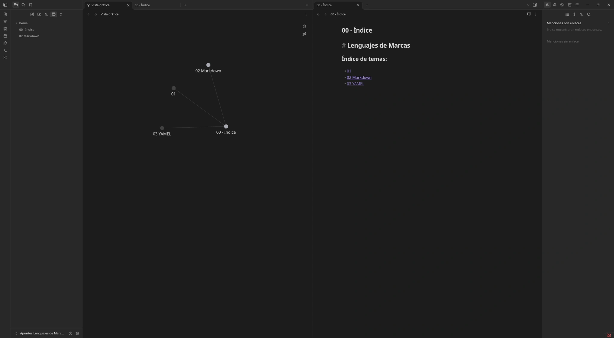

# ***Proyecto "LLMM01"***

Proyecto para la asignatura "Lenguaje de Marcas" encuadrada dentro del Grado Superior de FP "Desarrollo de Aplicaciones Multiplataforma o DAM" del IES Juan de Garay (Valencia)

| ASIGNATURA | ALUMNO | PROFESOR | VERSIÓN | F. ÚLTIMA ACTU. |
| :--------: | :----- | :------- | :-----: | --------------: |
| Lenguajes de Marcas | "EPS" | "PLC" | 0.0.4 | 18.10.2026 |

- El objetivo del proyecto es crear una bóveda de Obsidian, donde estarán los apuntes de la asignatura, de libre acceso; consulta y edición. De forma que el alumnado pueda usarlos para sacar adelante la asignatura.

- Una vez la bóveda esté terminada, se puede difundir su ubicación en Githud para que los alumnos del centro (o incluso de otros), puedan acceder a ella.

- El proyecto, al igual que la asignatura, estará construido con lenguajes de marcas, por lo que, entre los recuros que podremos encontrar en el repo estarán archivos de estos tipos (.md .html .json etc...), además de imágenes que puedan ayudar a la comprensión de la información contenida en el mismo.

## **ÍNDICE DE CONTENIDOS**

*Aunque es un proyecto aún en desarrollo*, se intentará mostrar en la medida de lo posible, los contenidos almacenados dentro del proyecto, aunque no siempre estos puedan estar completos y, obviamente, no representen la totalidad del contenido final del proyecto.

- Índice por temas:

    - [ ] Tema 1. Introducción a los Lenguajes de Marcas.
    - [ ] Tema 2. **Markdown y Yaml.**
    - [ ] Tema 3. HTML parte 1.

Conforme se avance en la asignatura, se irán incorporando los nuevos temas a este repo y, cuando el tema esté cerrado (es decir, con toda la información concerniente al tema subida debidamente esquematizada, organizada y resumida) el checkbox del tema aparecerá como marcado.

Vista general del índice del proyecto dentro de Obsidian:

